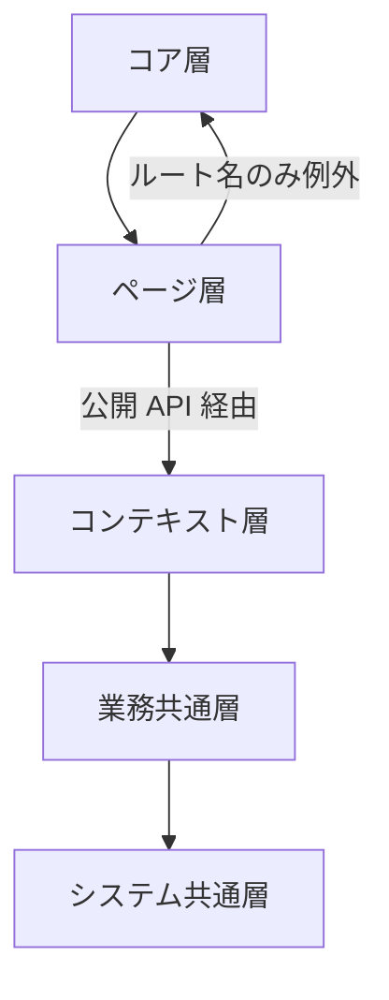

# フロントエンドアプリケーションのアーキテクチャ {#top}

## 技術スタック {#technology-stack}

AlesInfiny Maia OSS Edition （以降、 AlesInfiny Maia ）を構成する OSS を以下に示します。

{ loading=lazy }
{ loading=lazy }

!!! note ""

    上の図で使用している OSS 製品名およびロゴのクレジット情報は [こちら](../../../about-maia/credits.md) を参照してください。

利用ライブラリの一覧については、 [技術スタック](../csr-architecture-overview.md#technology-stack) を参照してください。

## アーキテクチャ {#frontend-architecture}

### MVVMパターン {#mvvm-pattern}

AlesInfiny Maia で採用している Vue.js のソフトウェア・アーキテクチャは MVVM パターンに分類されます。
以下にアーキテクチャを示します。

{ loading=lazy }
{ loading=lazy }

<!-- markdownlint-disable-next-line no-emphasis-as-heading -->
**ビュー**

:  ブラウザーへのレンダリングおよびブラウザーからのイベントの待ち受けを役割として担います。ビューには UI の構造やスタイルを定義します。

<!-- markdownlint-disable-next-line no-emphasis-as-heading -->
**ビューモデル**

:  ブラウザーからのイベントを受け、プレゼンテーションロジックを実行します。ビューモデルのプレゼンテーションロジックには、レンダリングに必要な処理や入力チェック、モデルを通じたデータの取得や更新などの処理を実装します。

<!-- markdownlint-disable-next-line no-emphasis-as-heading -->
**モデル**

:  状態管理やブラウザー外部との入出力を担い、データ構造やデータの状態管理、 Web API 呼び出しや Web API 呼び出し結果のハンドリングなどの処理を実装します。

<!-- textlint-disable -->
Vue.js ではビューとビューモデルを [単一ファイルコンポーネント(SFC) :material-open-in-new:](https://ja.vuejs.org/guide/scaling-up/sfc){ target=_blank } と呼ばれる同一のファイル(拡張子.vue)に記述できるので、図ではビュー&ビューモデルと表現しています。
<!-- textlint-enable -->

### ビュー＆ビューモデル コンポーネント {#view-and-viewmodel-component}

{ loading=lazy }
{ loading=lazy }

ビューとビューモデルはそれぞれブラウザーへのレンダリングとそのブラウザーから受けたイベントに対するプレゼンテーションロジックなどを行うコンポーネントです。
ブラウザーに表示する画面は Component という複数の画面構成要素と View というそれらを組み合わせたページから構成されます。
これらの画面コンポーネントが、デザインやデータバインドなどの画面表示（ビュー）と、イベント処理や入力処理などの画面要素に対する処理（ビューモデル）を持っています。

#### 画面コンポーネント {#screen-components}

Vue.js はコンポーネント指向のフレームワークであることから画面要素を Component という再利用可能な単位で分割し、複数の画面コンポーネントを組み合わせることによってひとつの画面(View)を構成します。
View がルーティングによって遷移される画面として指定されます。画面コンポーネントは実際の画面では以下のようなイメージになります。

{ loading=lazy }
{ loading=lazy }

#### 画面遷移 {#screen-transition}

画面遷移には、 Vue Router という Vue.js の拡張ライブラリを利用します。 Vue Router はルーティング定義に基づいて遷移先の画面コンポーネントを特定し、表示する画面コンポーネントを切り替えることで画面遷移を実現します。 Vue Router による画面遷移はフロントエンドのみで完結するためバックエンドへ通信しません。また AlesInfiny Maia では、「View」を切り替えの単位としています。

Vue Router: [公式ドキュメント :material-open-in-new:](https://router.vuejs.org/introduction.html){ target=_blank }

{ loading=lazy }

{ loading=lazy }

#### モデルコンポーネントとの連携 {#linkage-with-model-component}

Vue.js ではバックエンドアプリケーションとの連携をモデルが行います。そのため、ユーザーが行う画面コンポーネントからの処理や入力情報をモデルに連携する必要があります。この連携ではビューモデルのプレゼンテーションロジックから、後述するモデルコンポーネントの Service や Store の Action を呼び出すことで、データの取得・更新をします。

#### フロント入力チェック {#input-validation}

文字種や文字数などの入力チェックは、ビューモデルで行い、不要なバックエンドとの通信の発生を防止します。  AlesInfiny Maia では VeeValidate と Zod という OSS ライブラリを利用します。 VeeValidate はフォームや入力コンポーネントを監視し、 Zod は検証スキーマを定義する OSS です。

{ loading=lazy }
{ loading=lazy }

### モデルコンポーネント {#model-component}

{ loading=lazy }
{ loading=lazy }

モデルはデータの状態管理や画面(ビュー)へのデータ連携、 Web API の呼び出しおよびハンドリングなどの役割を持つコンポーネントです。モデルは以下の要素で構成されます。またフロントエンドで扱うデータモデルと API モデルとの乖離を吸収し、扱いやすい状態に加工する役割も持ちます。

- Service: ビューモデルからのリクエストに対して、 Store の呼び出し、 Web API の呼び出しなどデータの連携に必要な処理をします。
- Store: フロントエンドで扱う状態を保持するコンテナです。 AlesInfiny Maia では Pinia という Vue.js の Store ライブラリを利用して管理します。

Pinia: [公式ドキュメント :material-open-in-new:](https://pinia.vuejs.org/introduction.html){ target=_blank }

ただし、このモデルの構成は複雑な状態管理をするアプリケーションを想定しており、小規模なアプリケーションや状態管理を必要としないページの場合は、 Service やモデルを省略することも考えられます。この場合は、ビューモデルから直接 Web API を呼び出します。

#### Storeの構成要素 {#store-structure}

Pinia における Store は、 State・Getter・Action という 3 つの要素から構成されています。

{ loading=lazy }
{ loading=lazy }

| 要素   | 説                                                                                                                                                                                   |
| ------ | ------------------------------------------------------------------------------------------------------------------------------------------------------------------------------------ |
| State  | Store で管理するデータそのもの。                                                                                                                                                     |
| Getter | State の値や State から算出した結果を返すもの。                                                                                                                                      |
| Action | Store で管理しているデータである State に対して変更を行うもの。また API の呼び出しや API のレスポンスのハンドリングを行うもの。原則として、 State の変更を伴わない処理を持たせない。 |

Store は State をグローバルなシングルトンとして管理します。そのため本来 State は直接取得・更新ができますが、 Getter と Action を通じてアクセスするルールを設けて State の参照・更新を制御し、データの一貫性を持つことが重要です。

#### State の更新 {#update-state}

State の更新は Action を利用します。この際、ビューモデルから Service を経由して Action を呼び出すことで、 State の更新を一元管理します。

#### State の参照 {#get-state}

State の参照には Getter を利用します。 Getter は State を参照できますが、 State の値は変更できません。そのため安全に State の値を参照できます。

#### バックエンドとのAPI連携 {#communicate-with-backend}

AlesInfiny Maia では API 仕様を OpenAPI を用いて作成します。ここには API の機能が説明されており、フロントエンドエンジニアとバックエンドエンジニアの間で API 設計に乖離が生じないようにします。
また [OpenAPI generator :material-open-in-new:](https://github.com/OpenAPITools/openapi-generator){ target=_blank } というツールを利用して、 API クライアントコードを自動生成できます。
AlesInfiny Maia ではクライアント API アクセス方式に、 Promise ベースでリクエストの設定が容易である Axios を採用しています。

OpenAPI: [公式ドキュメント :material-open-in-new:](https://swagger.io/specification/){ target=_blank }

Axios: [github :material-open-in-new:](https://github.com/axios/axios){ target=_blank }

{ loading-lazy }
{ loading-lazy }

!!! note ""

    上の図で使用している OSS 製品名およびロゴのクレジット情報は [こちら](../../../about-maia/credits.md) を参照してください。

!!! note "OpenAPI Generator の自動生成コード"
      OpenAPI Generator はサーバー、クライアント双方の様々なコードの自動生成に対応しています。生成可能なコードについては公式ドキュメントを参照してください。

      - [OpenAPI Generator: Generators List :material-open-in-new:](https://openapi-generator.tech/docs/generators){ target=_blank }

<!-- バックエンド編のAPIドキュメントへリンク -->

## フォルダー構成 {#project-structure}

`src` フォルダーの直下は、 `views` や `services` のようなコードの種類ではなく、業務の関心事を単位に構成します。
フォルダー名を見れば、どの業務の機能のコードが格納されているかわかるようにするためです。
ただし、複数の業務で使うコードや、業務に依存しないコードのような、横断的な関心事を持つコードもあります。
それらを置くフォルダーも、業務のフォルダーと並べて設けます。
フォルダー構成の全体像を以下に示します。

```text title="プロジェクトのフォルダー構成全体像" linenums="0"
<workspace-name>
├─ public/ ------------------- ビルドで加工せずに配信するファイル（ favicon など）を格納します。
├─ src/
│  ├─ core/ ------------------ アプリケーション全体で利用するコードを格納します。
│  ├─ pages/ ----------------- 画面コンポーネントを、 URL のパスと対応させて格納します。
│  ├─ system-common/ --------- 業務知識を持たない、システム全体で使うコードを格納します。
│  ├─ business-common/ ------- 業務知識を持ち、複数のコンテキストで使うコードを格納します。
│  ├─ <context>/ ------------- 個別の業務コンテキストです。公開 API とドメインのフォルダーを格納します。
│  │  ├─ <domain>/ ----------- 個別の業務ドメインです。コンポーザブルやコンポーネントのフォルダーを格納します。
│  │  └─ public-api.ts ------- コンテキスト内のコードのうち、ページ層とコア層で使うものを公開します。
│  ├─ App.vue
│  └─ main.ts
├─ index.html
└─ package.json
```

`src` の下のコードは、以下の 5 つの層に分かれます。
層は、参照される側ほど**業務知識**（業務のルールや業務で使う用語に依存する知識）が少なくなるように並べています。

- **コア層**: `main.ts` 、 `App.vue` 、 `core` フォルダーからなる最上位の層です。ルーターやスタイルシートなど、アプリケーション全体の中核として利用するコードを配置します。
- **ページ層**: ルーティングの対象となる画面コンポーネントを、 URL に沿って配置します。画面コンポーネントは、各コンテキストや共通層から UI やロジックを読み込んで画面を構成します。
- **コンテキスト層**: `src` の直下に置く、業務上のまとまりです。境界付けられたコンテキスト（ Bounded Context ）に相当し、同じ用語が同じ意味で通じる範囲を表します。コンテキスト層は、ドメインと公開 API によって構成します。
    - **ドメイン**: コンテキストの直下に置くフォルダーです。ひとつの業務の関心事を表します。
    - **公開 API**: ページ層とコア層からコンテキストを参照するための入口（ `public-api.ts` ）です。ページ層とコア層で使うものだけを公開します。
- **業務共通層**: 業務知識を持つものの、持ち主となるコンテキストを決められないコードを置く層です。 `business-common` フォルダーに対応します。
- **システム共通層**: 業務知識を持たないコードを置く層です。 `system-common` フォルダーに対応します。

参照は、コア層からシステム共通層へ向かう一方向に限り、逆向きの参照は禁止します。
参照を一方向に限ると、ある層を変更したときに影響を受けるのは、その層を参照する側の層だけになります。
そのため、変更の影響範囲を特定しやすくなります。



??? info "ルート名の定義を例外とする理由"
      ページ層からコア層のルート名の定義（ `core/router/route-names.ts` ）の参照は例外として認めます。
      目的は、ルート名とパラメーターの型の対応とともに、ルート名をルーターの設定と同じコア層で一元管理するためです。
      ページ層では、遷移先の画面をコア層からインポートしたルート名で指定します。
      しかし、このファイルは定数と型だけを持ち、ページ層を参照しないので、循環参照による問題は生じません。

### ドメイン内のフォルダーの構成 {#domain-folders}

各ドメインの下には、機能の実現に必要な UI とロジックのコードを格納するために、以下のフォルダーを必要に応じて配置します。

| フォルダー    | 格納するもの                                            |
| ------------- | ------------------------------------------------------- |
| `composables` | 状態のリアクティブな反映など、 Vue に依存するロジック。 |
| `components`  | 画面を構成するための UI コンポーネント。                |
| `services`    | Web API の呼び出しなど、 Vue に依存しないロジック。     |

表のフォルダーは代表例であり、ドメインの関心事に応じてフォルダーを追加して構いません。
たとえばサンプルアプリケーションには、 Pinia ストアを格納する `stores` や、入力チェックの規則を格納する `validation` があります。

### pages フォルダーの構成 {#pages-folders}

pages フォルダーは、ルーティングの対象となる画面を格納します。
フォルダー構成は URL のパスと対応させます。
たとえば、サンプルアプリケーションの `/catalog/items/edit/:itemId` という URL の画面は、 `pages/catalog/items/edit/ItemsEditPage.vue` です。

```text title="サンプルアプリケーションの pages フォルダー" linenums="0"
src/
└─ pages/
   ├─ authentication/
   │  └─ login/
   │     └─ LoginPage.vue ---- /authentication/login
   ├─ catalog/
   │  └─ items/
   │     ├─ add/
   │     │  └─ ItemsAddPage.vue ---- /catalog/items/add
   │     ├─ edit/
   │     │  └─ ItemsEditPage.vue --- /catalog/items/edit/:itemId
   │     └─ ItemsPage.vue -------- /catalog/items
   ├─ ErrorPage.vue -------------- /error
   ├─ HomePage.vue --------------- /
   └─ NotFoundPage.vue ----------- 該当する画面がない URL
```

### テストファイルの配置 {#test-file-placement}

テストファイルは、テスト対象と同じフォルダーの下に `__tests__` フォルダーを作って配置します。
テストコードを対象の近くへ置きながら、実装のファイルと混在させないためです。
ドメイン内のフォルダーだけでなく、ページ層やコア層のフォルダーも同様です。

```text title="テストファイルの配置" linenums="0"
src/
├─ core/
│  └─ router/
│     ├─ __tests__/
│     │  └─ routes.spec.ts
│     └─ routes.ts
├─ pages/
│  └─ basket/
│     ├─ __tests__/
│     │  └─ BasketPage.spec.ts
│     └─ BasketPage.vue
└─ security/
   └─ authentication/
      └─ composables/
         ├─ __tests__/
         │  └─ use-authentication.spec.ts
         └─ use-authentication.ts
```
